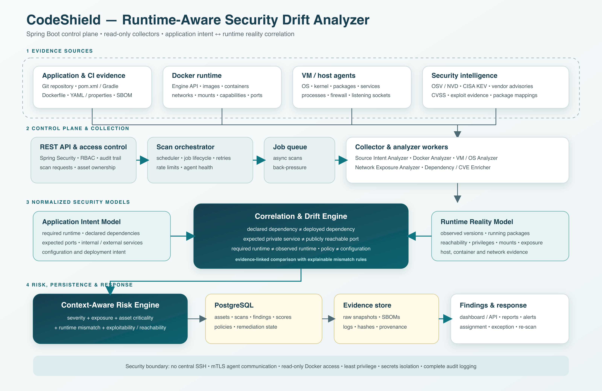

# CodeShield: Context-Aware SecOps Platform for Detecting Application–Infrastructure Security Drift

CodeShield is a runtime-aware security analysis platform designed to detect mismatches between what an application declares it needs and what its deployed infrastructure actually exposes or executes.

Instead of producing an isolated list of vulnerabilities, packages, or open ports, CodeShield correlates application source code and configuration with evidence collected from Docker containers, virtual machines, operating systems, processes, dependencies, and networks. The result is an explainable view of application–infrastructure security drift.

## Problem statement

Conventional scanners usually examine source code, dependencies, container images, hosts, or network exposure separately. This creates large volumes of findings without answering the most important contextual questions:

- Is an exposed service actually required by the application?
- Should the service be public or restricted to an internal network?
- Does the deployed runtime match the version declared by the application?
- Is a vulnerable dependency installed, loaded, reachable, or exploitable?
- Has the live container drifted from its image, SBOM, or deployment configuration?
- Does a container have privileges, capabilities, or mounts that its workload does not require?

CodeShield addresses this gap by comparing two security models:

1. **Application Intent** — derived from source code, build files, configuration, deployment manifests, Dockerfiles, and SBOMs.
2. **Runtime Reality** — derived from Docker, VM, operating-system, package, process, privilege, and network observations.

## Core research contribution

The central contribution is an evidence-linked correlation engine that detects and explains security drift across application and infrastructure layers.

Example:

```text
Application intent:
Redis is required as an internal service.

Runtime reality:
Redis is listening on 0.0.0.0:6379 and is publicly reachable.

CodeShield finding:
Required service is present, but its actual exposure violates the
application's intended trust boundary.

Risk: Critical
```

## System architecture



The editable vector version is available in [CodeShield_System_Architecture.svg](CodeShield_System_Architecture.svg).

### 1. Evidence sources

- Git repositories and CI/CD artifacts
- `pom.xml` and Gradle build files
- `application.yml` and `application.properties`
- Dockerfiles, Compose files, and deployment manifests
- Software Bills of Materials
- Docker Engine and image metadata
- Lightweight VM or host agents
- Operating-system, kernel, package, service, and process information
- Firewall rules and listening sockets
- OSV, NVD, CISA KEV, and vendor security advisories

### 2. Spring Boot control plane

The Spring Boot service acts as the central control plane and provides:

- REST APIs
- Spring Security authentication and role-based authorization
- Scan scheduling and job lifecycle management
- Asynchronous worker coordination
- Agent health monitoring
- Asset ownership and scope management
- Audit logging
- Findings, reports, and remediation workflows
- Actuator health and metrics endpoints

The control plane should not SSH into managed hosts. Host evidence should be collected by a small, authenticated agent and transmitted over mutually authenticated TLS.

### 3. Collector and analyzer workers

#### Source Intent Analyzer

Parses application and deployment artifacts to infer:

- Required Java and framework versions
- Declared direct and transitive dependencies
- Database, cache, messaging, and external-service requirements
- Expected application ports
- Intended internal and external services
- Authentication and transport-security settings
- Environment-specific configuration

#### Docker Analyzer

Collects read-only Docker evidence, including:

- Containers and images
- Image digests and versions
- Published and exposed ports
- Networks and network modes
- Volumes and host mounts
- Environment variables
- Linux capabilities
- Privileged mode
- Container users and root execution
- Runtime processes
- Docker socket exposure

#### VM and OS Analyzer

Collects host evidence, including:

- Operating system and kernel
- Installed packages
- Running services and processes
- Users and permissions
- Listening sockets
- Firewall configuration
- CPU and memory information
- Runtime versions
- Agent health and evidence freshness

#### Dependency and Vulnerability Analyzer

- Builds declared and observed dependency inventories
- Compares deployed packages with build and SBOM records
- Maps packages to known vulnerabilities
- Incorporates CVSS, CISA KEV, exploit evidence, and vendor advisories
- Adds reachability or exploitability evidence when available
- Detects declared-versus-runtime dependency mismatches

#### Network Exposure Analyzer

- Classifies ports as loopback, private, host, cluster, or Internet reachable
- Maps listening services to application requirements
- Identifies unnecessary or unexpectedly public services
- Detects missing authentication, encryption, or segmentation controls

## Correlation and drift engine

The correlation engine normalizes evidence into intent and runtime facts and applies explainable comparison rules.

Representative drift rules include:

| Intent | Runtime reality | Example finding |
|---|---|---|
| Java 21 required | Java 17 running | Runtime compatibility and patching risk |
| PostgreSQL internal | `0.0.0.0:5432` publicly reachable | Database trust-boundary violation |
| Redis internal | Host port `6379` published | Unnecessary external exposure |
| Non-root container expected | Container runs as root | Excessive runtime privilege |
| No host control access required | Docker socket mounted | Host-compromise path |
| Dependency version X declared | Version Y deployed | Dependency or SBOM drift |
| Minimal capabilities expected | `SYS_ADMIN` or broad capabilities granted | Container escape risk |
| Approved image digest | Different digest running | Deployment integrity drift |

Every finding should retain links to the evidence that caused it so a user can understand and reproduce the decision.

## Context-aware risk scoring

The first implementation can use transparent rules rather than machine learning.

```text
Risk score =
    vulnerability severity
  + network exposure
  + asset criticality
  + application–runtime mismatch
  + exploitability or reachability
  + privilege and blast radius
  - verified compensating controls
```

The score should never rely on CVSS alone. For example, a reachable vulnerable component on an Internet-facing payment service should be prioritized above a higher-CVSS package that is installed but unused and inaccessible.

## Main findings model

A finding should contain at least:

- Finding identifier and rule identifier
- Application, asset, host, container, and image identifiers
- Category and severity
- Human-readable title and explanation
- Expected state
- Observed state
- Evidence references and collection timestamps
- CVE, CWE, CVSS, KEV, and exploit metadata when applicable
- Reachability and network-exposure context
- Recommended remediation
- Owner, status, exception, and re-scan information

## Technology stack

| Layer | Suggested technology |
|---|---|
| Control plane | Java 21 and Spring Boot 3.x |
| Security | Spring Security, RBAC, mTLS, scoped service identities |
| API | Spring Web / REST |
| Health and metrics | Spring Boot Actuator and Micrometer |
| Persistence | PostgreSQL |
| Asynchronous scans | Spring scheduling plus a durable queue when scale requires it |
| Docker collection | Read-only Docker Engine API |
| Host collection | Small Java or native agent |
| Dependency parsing | Maven, Gradle, SBOM, and package-manager adapters |
| Vulnerability sources | OSV, NVD, CISA KEV, and vendor feeds |
| Dashboard | Any REST-compatible web frontend |


## Minimum viable product

The recommended MVP should support:

1. Registering an application, Docker Engine, and VM agent.
2. Parsing Maven or Gradle dependencies and Spring configuration.
3. Collecting Docker container, image, port, mount, user, and capability data.
4. Collecting host OS, kernel, package, process, and listening-port data.
5. Building application-intent and runtime-reality models.
6. Detecting version, dependency, port, privilege, mount, and exposure drift.
7. Enriching findings with verified vulnerability intelligence.
8. Producing an explainable risk score and prioritized findings list.
9. Storing evidence provenance and scan timestamps.
10. Supporting remediation status, exceptions, and re-scans.

## Security boundaries

- Do not use central server-side SSH for routine host inspection.
- Use mutually authenticated TLS between agents and the control plane.
- Give Docker collectors read-only and narrowly scoped access.
- Never expose the Docker socket inside the CodeShield application container unless protected by a restricted proxy.
- Encrypt credentials and agent secrets at rest.
- Redact sensitive environment variables before persistence.
- Sign or hash collected evidence to preserve integrity.
- Record administrative actions and scan access in an audit log.
- Apply retention limits to raw evidence.
- Require human review before disruptive remediation.

## Evaluation plan

The project should be evaluated using controlled deployments containing seeded drift cases.

The included [CodeShield security drift benchmark dataset](CodeShield_Security_Drift_Benchmark_Dataset.xlsx) provides 120 deterministic cases with approved baselines, observed states, expected rule IDs, per-rule scores, severities, and train/validation/test partitions. It is synthetic test data aligned with the implemented CodeShield rules, not a record of real security incidents.

Recommended measures include:

- Precision, recall, and false-positive rate for each drift category
- Reduction in false positives after application context is added
- Accuracy of declared-versus-observed dependency matching
- Accuracy of internal-versus-public exposure classification
- Scan duration and host/container overhead
- Agent disconnect and stale-evidence handling
- Risk-score stability across repeated scans
- Evidence completeness and freshness
- Remediation verification through re-scanning
